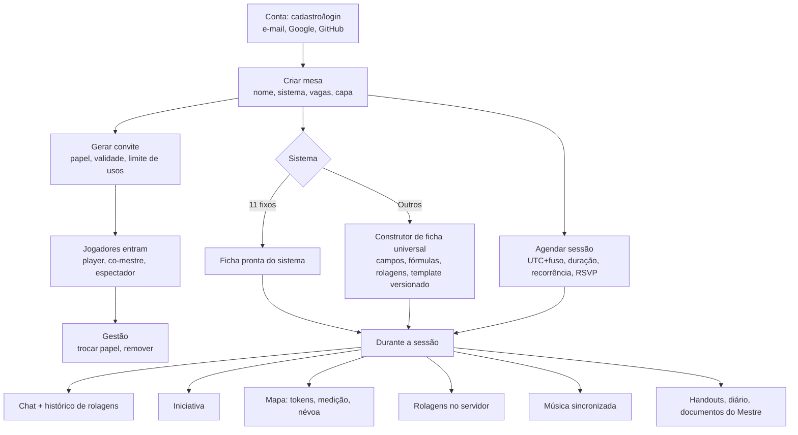

# Fluxo do mestre — Astralis

Fluxo completo de uso, da conta à mesa em jogo.

## Etapas

1. **Conta** (`src/AccountPanel.jsx`): Supabase Auth; e-mail/senha, Google, GitHub, recuperação, verificação de e-mail, perfil com avatar. Exportar dados e excluir conta (LGPD).
2. **Mesa** (`POST /api/rooms`): título, sistema, mestre, vagas, capa, agenda, classificação, gatilhos, resumo.
3. **Sistema**: 11 prontos ou **Outros** com ficha montada pelo mestre (seções, campos tipados, fórmulas seguras, rolagens por campo, template versionado, importar/exportar JSON).
4. **Convites** (`invite:create`): papel de entrada (jogador, co-mestre, espectador), validade, limite de usos, revogação. Gestão de participantes (`member:role`, `member:remove`).
5. **Agenda** (`appointment:add`/`appointment:rsvp`): horário em UTC exibido no fuso de cada um, duração, recorrência, link, confirmação de presença.
6. **Sessão**: chat com histórico de rolagens, rastreador de iniciativa, mapa com tokens/medição/névoa, rolagens sorteadas no servidor, música sincronizada, handouts, diário e documentos do Mestre.

Permissões: mestre e co-mestre gerem a mesa; só o mestre troca papéis e convites; jogador edita a própria ficha; espectador só lê (mas confirma presença).
